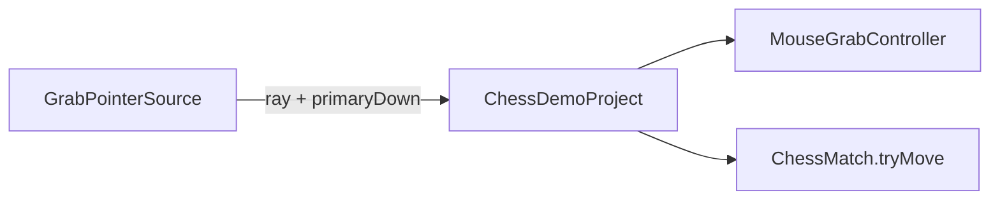

# Suite playtest

Évaluation des retours après [CHESS-B28](sprints/CHESS-B28.md). Les signaux portent les ids PT-004 à PT-007 dans [Plan QA](qa-alpha.md#retours-playtest). Le découpage est [CHESS-B29](sprints/CHESS-B29.md). Branche : `fix/playtestv2`.

## PT-004 — Tour en boucle au niveau 1

Pas un bug de couleur. Quand le joueur est noir, le CPU joue les blancs ; la navette se voit mieux.

[`HeuristicChessEngine`](../src/chess/rules/HeuristicChessEngine.ts) cherche en profondeur 1 au cran 1 (`cpuSearchDepth`). L’évaluation est matériel plus échec. Pas d’aléatoire, pas de répétition. À score égal, le premier coup de `legalMoves()` gagne. Les coups calmes (tour a1↔a2, roi a1↔b1) lient : l’IA oscille. Monter le cran à profondeur 2 ne suffit pas.

Correctif : pénalité sur l’annulation du coup précédent (ou du FEN précédent), sous TDD. Pas de changement de `shouldCpuReply`.

## PT-005 — Replay et analyse coach

Faisable. Pas un branchement mince.

Aujourd’hui : jusqu’à 24 SAN en mémoire, journal d’entraînement plus riche, coach commentaire seulement ([Coach](coach-ia.md)). La carte de fin n’offre pas d’analyse. Recommencer efface l’historique. Une partie finie ne s’enregistre pas ([Persistance](persistance.md)).

| Tranche | Taille | Contenu |
| --- | --- | --- |
| A | Petite | Depuis la carte de fin, ouvrir le coach sur la position finale. Garder l’historique tant qu’on reste à la table. |
| B | Moyenne | Journal ply (`fenBefore` + SAN) tous modes. Prev / next. Coach sur le ply choisi. Maquette prête ; client après « applique en prod ». |
| C | Grande | Archive des parties finies, PGN, rapport multi-appels. Hors de [CHESS-B29](sprints/CHESS-B29.md). |

Ce sprint livre A puis B. Pas d’archive.

## PT-006 — Saisie tactile, puis VR

Le ressort et les règles sont déjà indépendants de la souris : rayon → ancre XZ → ressort → relâche → `tryMove`. Le couplage souris vit dans [`ChessDemoProject`](../src/renderer/host/ChessDemoProject.ts) (NDC, `pointer`, action `select`, orbit partagé).

1. Touch : `InputManager` mappe déjà le doigt ; l’hôte passe par `sampleChessGrabPointer`. L’orbit est gelée pendant la prise (`chessOrbitInputActive`).
2. VR plus tard : même contrat avec un rayon contrôleur. Session XR, caméra et HUD 2D hors de ce sprint.

## PT-007 — Upscale flou

Attendu avec la chaîne actuelle ([Upscale](upscale.md)). Qualité et Natif rendent aux deux tiers, agrandissent en spatial, affûtent à 0,7. FXAA passe avant l’upscale. Pas de FSR2 ni de DLSS sans vecteurs de mouvement.

Améliorations sans réécrire le moteur : monter l’affûtage par défaut ou l’exposer en Options ; scale Qualité vers 0,75 ou 0,85 ; renforcer le shader spatial ; FXAA après l’upscale, ou réduit quand l’upscale est actif. Mesurer avec le [banc graphique](profil-graphismes.md).

## Ordre

1. PT-004 — correctif CPU.
2. PT-007 — affûtage / échelle.
3. PT-006 — abstraction pointeur et touch.
4. PT-005 — tranche A, puis B.

Sous `0.x`, le correctif CPU est un patch. Les livraisons tactile, replay et réglage d’upscale visibles sont des features : elles montent le minor.
